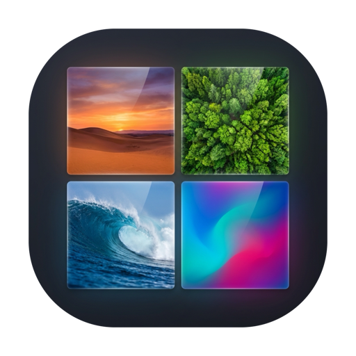

<div align="center">

  

  <h1>Wallpaper Selector</h1>

  <p><b>Your wallpapers. Fast, native, and out of the way.</b></p>

  <p>
    A native macOS menu-bar app for picking, rotating, and organizing local wallpapers.<br/>
    No Electron. No network. Your wallpaper folders stay on your Mac.
  </p>

  <p>
    <a href="https://github.com/wiggly-sheets/wallpaper-selector/actions"></a>
    <a href="https://github.com/wiggly-sheets/wallpaper-selector/releases/latest"></a>
  </p>

  <p>
    <a href="https://github.com/wiggly-sheets/wallpaper-selector/releases/latest"><b>Download</b></a>
    &nbsp;·&nbsp;
    <a href="#installation">Install guide</a>
    &nbsp;·&nbsp;
    <a href="#usage">Usage</a>
    &nbsp;·&nbsp;
    <a href="#build-from-source">Build from source</a>
    &nbsp;·&nbsp;
    <a href="#privacy">Privacy</a>
  </p>

</div>

---

Wallpaper Selector lives in your menu bar. Choose folders of images, set one
now, rotate them on a schedule, organize subsets into themes, and let light
and dark appearance choose different wallpapers.

## Features

- Menu-bar controls for the main window, preview, shuffle, next/previous,
  rotation, themes, recents, appearance matching, and settings
- Native picker with thumbnail grid, natural filename sorting, current-image
  checkmark, folders, and themes
- Vibrancy preview window, sized to its content and clamped to the visible
  frame of the display, anchored below the menu-bar icon
- Rotation: 30 minutes, hourly, 12 hours, daily; shuffle, sequential, and
  theme rotation modes (the theme modes need at least one theme)
- Light/dark theme and wallpaper pins, with automatic appearance switching
- Configurable global shortcuts and launch at login
- Menu-bar and Settings error reporting for failed wallpaper changes, for
  settings files that could not be written, and for shortcuts that another app
  already owns
- JSON settings, recent-wallpaper history, and direct external-settings sync
- Unreadable settings files are kept as `settings.json.corrupt` instead of
  being overwritten
- Every connected display receives wallpaper updates
- All Spaces: the wallpaper is written into the macOS wallpaper store, so it
  reaches every Space that holds its wallpaper in a slot the app writes

## Installation

### Homebrew

The cask lives in the
[wiggly-sheets/homebrew-tap](https://github.com/wiggly-sheets/homebrew-tap)
repository. The tap renders the cask from its own template and follows the
latest stable release.

```bash
brew install --cask wiggly-sheets/tap/wallpaper-selector
```

### Manual install

1. Download latest `.dmg` from [Releases](https://github.com/wiggly-sheets/wallpaper-selector/releases/latest).
2. Open it and drag **Wallpaper Selector** to Applications.
3. Launch app. On first run, choose one or more wallpaper folders.

### First open and macOS quarantine

Current releases are ad-hoc signed and not notarized. macOS may show a
quarantine warning on first open. Only bypass it for a DMG downloaded from the
[official releases page](https://github.com/wiggly-sheets/wallpaper-selector/releases/latest).

**Finder UI:** Open Applications, Control-click **Wallpaper Selector**, choose
**Open**, then choose **Open** again in macOS confirmation dialog.

**Terminal:** Remove quarantine from this app only, then launch it:

```bash
xattr -dr com.apple.quarantine "/Applications/Wallpaper Selector.app"
open "/Applications/Wallpaper Selector.app"
```

This is the macOS quarantine flag on the downloaded app. It is not related to
the `settings.json.corrupt` file described in [Settings file](#settings-file).

### All Spaces

macOS keeps the wallpaper of every Space in the store of its wallpaper agent.
When you turn All Spaces on, Wallpaper Selector writes the wallpaper into that
store and restarts the agent. The wallpaper that is on the screen is the one
that reaches every Space, also when it was changed in the System Settings and
not through the app. The wallpaper of the app is written only when no screen
reports one. The desktop flickers briefly while the agent restarts.

The app takes a one-time backup of the store before it writes it for the first
time. The backup lives in
`~/Library/Application Support/WallpaperSelector/WallpaperIndex.plist.backup`
and is never overwritten. If the backup cannot be made, the app does not write
the store at all.

The app writes the wallpaper into every container of the store that holds a
wallpaper, and it checks every one of them afterwards. A Space whose wallpaper
sits in a slot the app does not write keeps its old wallpaper, and the app
reports that the wallpaper did not reach every Space.

A container of the store that is not a dictionary, or that has neither a type
nor a known wallpaper slot, stops the write: the store is not changed at all,
the wallpaper stays on the current Space, and the app reports that.

The store exists on macOS 14 and newer, so All Spaces needs macOS 14 or newer.
On macOS 13 the wallpaper stays on the current Space.

The app needs no Accessibility permission, and it opens no System Settings
window.

## Usage

### Menu bar

The menu bar menu shows the active theme (or All Folders), then:

- Open Main Window
- Preview Wallpapers
- Start Rotation or Stop Rotation
- Shuffle, Next Wallpaper, Previous Wallpaper
- Recent Wallpapers (only with history; the number of entries follows the
  Recent Wallpapers setting, 5, 10 or 20; an entry whose file is gone is
  shown grayed out)
- Rotate: interval and action
- Theme: All Folders and each theme
- All Spaces
- Match System Appearance
- Settings…
- Quit Wallpaper Selector

The menu is built once and updated in place. A menu that is already open
shows the current state: the checkmark of the active theme, the items that
are enabled and disabled, and the error item.

The rotation controls are disabled while Match System Appearance is on,
because the rotation is paused in that mode. This covers the Start Rotation
item and the Rotate submenu in the menu, the interval picker in the preview
window, the Rotation… button in the main window, and the Rotation pane in
the Settings window. The theme actions in the Rotate submenu are disabled in
the same state, because a theme action would show one theme and the wallpaper
of another one.

While Match System Appearance is on, the pinned wallpaper of the current
appearance is applied when the app starts, when the system changes appearance,
and when the pin, the theme or the matching itself changes. It is not applied
when the app only wakes up: a wallpaper picked by hand stays on the screen.
The start is a moment of its own: with the matching on, the pin replaces a
wallpaper that was picked by hand at every launch.

The theme buttons in the preview window are enabled whenever a theme exists
and Match System Appearance is off; the rotation interval does not matter
for them. The wallpaper buttons in the auto-rotate row of that window need
an interval other than Off.

#### Errors in the menu

When something fails, the menu shows a red, disabled item at the top, above
the theme name. It shows two failures at most: the wallpaper failure, which
also carries a failed settings write, and the shortcut failure. The wallpaper
error is cleared by the next settings change and when the next wallpaper
action starts. The shortcut error is cleared when the shortcuts are registered
again, which happens when the app becomes active again or when the shortcut
settings change.

A wallpaper that waits for a running rotation shows the deferral notice and
nothing else. A failure that is reported while the pick waits is not shown,
and the outcome of the pick is reported when it is applied.

- A wallpaper change that failed, for example
  `Failed to set wallpaper on 1 of 2 displays: …`,
  `No wallpaper folders are configured.` or
  `No wallpaper images were found in the selected folders.`
  A wallpaper that reaches at least one display is set on that display, and
  the displays that refused it are still reported. A failure while the app
  switches the wallpaper for the system appearance is reported the same way.
- A wallpaper that could not be put on every Space, for example
  `The wallpaper Sunset.jpg could not be put on every Space. This feature
  needs macOS 14 or newer, because this Mac has no wallpaper store.`
  The wallpaper stays on the current Space and the reason is named. The
  reason is named when the wallpaper agent of macOS did not come back, for
  example `The wallpaper agent of macOS did not come back, so the wallpaper
  cannot be checked.`, and when a Space keeps a wallpaper the app cannot
  write, for example `The wallpaper store holds a wallpaper that the app
  cannot write: Spaces.…`.
- A wallpaper that waits for a running rotation, for example
  `A rotation is in progress - the wallpaper will be applied when it
  finishes.` The pick is applied when the rotation is done.
- A global shortcut that another app already owns, for example
  `Could not register the shortcut ⌘⇧P. Another app may already use it.`
  A shortcut that cannot be read is reported the same way, for example
  `Could not read the shortcut ⌘⇧P.`
- A settings file that could not be written, for example
  `Could not save settings to /path/to/settings.json: …`. The failure is shown
  in the same red, disabled item as a wallpaper failure, and on the General
  pane of the Settings window.

The wallpaper of the system appearance is applied even when the write that
records it fails. The failed write is reported on its own.

The shortcut failure is also shown on the Shortcuts pane of the Settings
window.

### Preview window

The preview window opens below the menu-bar icon. It takes the height of its
content, so a longer list of wallpapers makes it taller, and it never grows
past the visible frame of the display. A body that does not fit scrolls, so
every control stays reachable.

### Main window

The main window shows the picker: a thumbnail grid of the images in the
active theme, with the current wallpaper marked. The toolbar has the theme
menu, the All Spaces switch, the previous, shuffle and next buttons, and
buttons for the rotation, appearance, folders and themes sheets, and a button
that opens the Settings window. The appearance sheet sets the theme used in
light and in dark appearance and pins a wallpaper for each of them. The light
pin is stored in the light appearance theme and the dark pin in the dark
appearance theme, because that is the scope the app reads a pin from. Without
such a theme the pin is stored in the all folders pin of that appearance. Each
picker offers the images of the scope the pin is stored in, and the sheet
names that scope. A theme pin can only be an image of the folders of that
theme; a theme without folders of its own uses the images of all configured
folders.

### Settings window

The Settings window has six panes. Changes save automatically. The app theme
in the Appearance pane applies to the running app and is not saved.

- General: launch at login, the number of recent wallpapers to remember
  (5, 10 or 20), the settings location, and the settings and wallpaper errors
- Appearance: app theme (Auto, Light, Dark), match system appearance, All
  Spaces, which puts the wallpaper on every Space, the theme used in light
  and dark appearance, and the wallpaper
  pinned for light and dark appearance, used while no theme is set for that
  appearance, chosen from the images of all configured folders. The pin
  picker of an appearance is disabled while a theme is set for that
  appearance, because the theme owns the pin then. The pins of the
  appearance themes themselves are set in the Appearance sheet of the
  main window
- Shortcuts: Show Main Window, Show Preview, Open Menu Bar Menu, and the error
  for a shortcut that could not be registered
- Folders: the wallpaper folders, each with the absolute path the app uses
- Themes: the themes
- Rotation: interval and action; the theme actions need at least one theme

### Settings file

Settings live in `settings.json` in
`~/Library/Application Support/WallpaperSelector/`, or in the folder chosen in
the General pane. A change is applied in memory at once: the new settings are
normalised, stored and published, and the app reacts to them right away. The
file is written in the background, on a queue of its own, so the user
interface never waits for the disk. A write that fails keeps the content the
file had and is reported. The app also reloads the file when it is edited
outside the app.

When no `settings.json` exists yet, the app imports the settings from the
older `~/.wallpaper-selector/settings.json` location. After a successful
import the legacy file is renamed to `settings.json.migrated` next to it, and
its bytes are kept. If that rename fails, for example because the folder is
read-only, the app reports that the legacy settings were imported but the
legacy file could not be moved aside, and the file stays. A legacy file that
is still there on a later launch is not imported again: when it holds the
settings the app already has, the import already happened, so the file is
moved aside now. When it holds other settings, the app reports it on the
General pane and keeps the file, so you can import it by hand. If the legacy
file cannot be read, the app reports the error on the General pane and keeps
the file, so you can recover it by hand.

A folder path in the file is always absolute. A relative path is resolved
against your home directory and a `~` is expanded. A path of `.` or `..` is
dropped.

Choosing another settings folder in the General pane writes the current
settings into that folder. A settings file that already exists in the chosen
folder is adopted and is not overwritten. The file in the old folder is
renamed to `settings.json.migrated` next to it, so it can never be adopted
silently again, and its bytes are kept. An older `settings.json.migrated` in
that folder is replaced. If the rename fails, for example because the old
folder is read-only, the app reports the failure and the old file stays.

If `settings.json` cannot be read at startup, for example after a hand edit
that breaks the JSON, the app moves the unreadable file to
`settings.json.corrupt` next to it, reports the error on the General pane of
the Settings window, and starts with default settings, writing a new
`settings.json`. The original bytes stay in the `.corrupt` file, and an
older `.corrupt` file is replaced. If the unreadable file can be neither moved
nor copied, the app leaves it in place instead of overwriting it. This file is
not related to the macOS quarantine of downloaded apps: see
[First open and macOS quarantine](#first-open-and-macos-quarantine).

## Build from source

Requirements:

- macOS 13 or newer (the All Spaces feature needs macOS 14 or newer)
- Xcode 15 or newer
- `create-dmg`, needed by `make dmg` and `make release-artifacts`:
  `brew install create-dmg`

```bash
git clone https://github.com/wiggly-sheets/wallpaper-selector.git
cd wallpaper-selector
make test
make run
```

Useful commands:

```bash
make bundle                       # dist/Wallpaper Selector.app
make install                      # ~/Applications/Wallpaper Selector.app
make release-artifacts VERSION=1.0.0
```

`make release-artifacts` creates a versioned DMG and `.sha256` checksum under
`release/`. A local `make dmg` skips the Finder window layout, while the DMG
published by the release workflow is finalized and keeps it.

## Privacy

Wallpaper Selector runs locally. Folder paths, themes, shortcuts, and history
stay in `~/Library/Application Support/WallpaperSelector/settings.json` unless
you choose a different settings folder. It does not upload images, settings,
or usage data.

## Releases and Homebrew

Pushing tag `vX.Y.Z` runs release workflow, builds DMG plus SHA-256 checksum,
and publishes GitHub release. The
[wiggly-sheets/homebrew-tap](https://github.com/wiggly-sheets/homebrew-tap)
repository renders its own cask from its own template and follows the latest
stable release, so a release needs no manual copy into the tap.
